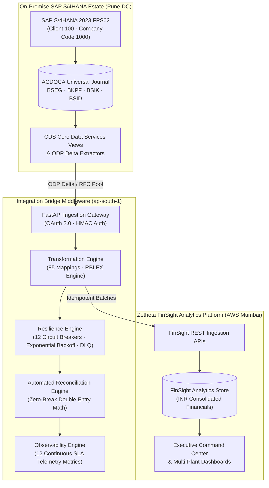

# Integration Bridge: SAP S/4HANA to FinSight Analytics Connector

> **Enterprise Technology / API Integration / FinTech & Analytics Externship**  
> **Client:** Meridian Manufacturing Ltd (INR 2,400 Crore Revenue · 7 Manufacturing Plants)  
> **Target Analytics:** Zetheta FinSight Financial Analytics Platform (ap-south-1 India Data Residency)  
> **Role:** Forward Deployed Engineer (FDE)  

---

## 📌 Executive Overview

Meridian Manufacturing Ltd is a premier mid-sized Indian manufacturer operating across 7 manufacturing plants in Maharashtra, Gujarat, and Tamil Nadu. While core enterprise transactions run on **SAP S/4HANA (2023 FPS02)**, financial intelligence was historically constrained by legacy batch extractions operating with a 24-hour delay.

**Integration Bridge** is an enterprise-grade custom integration framework that connects simulated SAP S/4HANA ERP instances with the **FinSight Analytics** platform. It eliminates financial data silos, enforces strict Indian regulatory compliance (GST splits under Companies Act 2013 / Schedule III, RBI data residency in `ap-south-1`, and FEMA currency rules), and reduces data availability lag from **24 hours to under 4 hours (an 83% improvement)**.

---

## 🏗️ System Architecture & C4 Model



### Key Architectural Tenets
1. **Universal Journal Single Source of Truth**: Integrates directly with SAP's ACDOCA table semantics, replacing fragmented legacy tables (BSEG, BSIK, BSID).
2. **ODP Delta Change Capture**: Extracts only net-new and modified financial postings without triggering full table locks or violating SAP RFC pool ceilings (max 50 concurrent connections).
3. **Double-Entry Mathematical Invariant**: Validates $\sum \text{Debits} = \sum \text{Credits}$ with an automated zero-break reconciliation engine before ledger consolidation.
4. **Resilience & Fault Isolation**: Dedicated 3-state circuit breakers across all 12 domains, exponential backoff with jitter, and an audited Dead Letter Queue (DLQ) with inspection and in-flight payload patching.
5. **India Localization & Regulatory Sovereignty**: Native Indian fiscal year periods (April–March V3), intra-state (CGST + SGST) vs inter-state (IGST) tax reconciliation, and RBI-mandated data localization within Indian AWS regions (`ap-south-1`).

---

## 🚀 Live Working Full-Stack Application

The repository includes a production-grade, working demonstration platform:

* **Backend (`app/backend`)**: FastAPI, Motor / Mongomock, Uvicorn, PyJWT authentication, PBKDF2 cryptography.
* **Frontend (`app/frontend`)**: React 18, TypeScript, Vite, Tailwind CSS, Recharts, Lucide Icons, Radix UI.

### 9 Fully Operational Sidebar Modules:
1. **Executive Command Center (`/`)**: Real-time KPI summaries, 30-day sync volume, pipeline topology status, financial flow charts.
2. **SAP ERP Simulator (`/simulator`)**: 12 SAP domains, realistic test batch generator, searchable line items, raw OData/IDoc payload inspector.
3. **API Management (`/api-management`)**: 24-endpoint catalog (12 SAP source + 12 FinSight target), live latency tracker, endpoint probe tester, circuit breaker outage simulator.
4. **Data Transformation (`/transformation`)**: Catalog of 85 field mappings, RBI daily reference FX rates engine, interactive payload transformation sandbox.
5. **Data Synchronization (`/synchronization`)**: ODP delta extraction runner (checksum / doc_id), execution history, configurable automated cron schedules.
6. **Reconciliation (`/reconciliation`)**: Debit/Credit balance verifier, source-to-target variance analyzer, automated variance ledger adjustment.
7. **Error Management & DLQ (`/error-management`)**: 10-class error taxonomy, 12 domain circuit breaker state machines, dead-letter queue with payload patching and requeue.
8. **Observability & Monitoring (`/monitoring`)**: 12 live telemetry metrics (Appendix F), active SLA breach alert panel, 24-hour latency and throughput trend charts, threshold editor.
9. **Financial Analytics (`/analytics`)**: Consolidated INR financials, EBITDA margin, 12-month FY cash flow trajectory, AP/AR aging analysis (0-30, 31-60, 61-90, 90+ days), 7-plant performance comparison table.

---

## 📂 Project Deliverables & Submission Index

Per ZeTheta's 15-Day Methodology and Deliverable Requirements (Part D & F), the formal documentation and specifications are cataloged below:

| ID | Formal Deliverable Title | Description & Scope | File Link |
| :--- | :--- | :--- | :--- |
| **D1** | **Integration Architecture Document** | C4 Diagrams (Levels 1–3), Network Topology, Tech Stack Justification, Non-Functional Requirements | [`docs/D1_Integration_Architecture_v1.0.md`](docs/D1_Integration_Architecture_v1.0.md) |
| **D2** | **API Specifications (OpenAPI 3.0)** | 12 SAP Source + 12 FinSight Target endpoints, OAuth 2.0, rate limits, pagination, and error schemas | [`docs/D2_API_Specification_v1.0.md`](docs/D2_API_Specification_v1.0.md) |
| **D3** | **Data Transformation Specification** | 85 field mappings across 12 domains, validation rules, currency & fiscal period mapping logic | [`docs/D3_Data_Transformation_Specification_v1.0.md`](docs/D3_Data_Transformation_Specification_v1.0.md) |
| **D4** | **Error Handling & Retry Framework** | 10 error classes, exponential backoff with jitter formula, 12 circuit breakers, DLQ architecture | [`docs/D4_Error_Handling_Framework_v1.0.md`](docs/D4_Error_Handling_Framework_v1.0.md) |
| **D5** | **Reconciliation & Data Quality Logic** | 4-dimension reconciliation, mathematical proof formulas, 25+ DQ rules, daily/monthly report formats | [`docs/D5_Reconciliation_Framework_v1.0.md`](docs/D5_Reconciliation_Framework_v1.0.md) |
| **D6** | **Monitoring & Alerting Specification** | 12 monitoring panels (Appendix F), Prometheus metric queries, refresh rates, P1–P4 alert rules | [`docs/D6_Monitoring_Alerting_Specification_v1.0.md`](docs/D6_Monitoring_Alerting_Specification_v1.0.md) |
| **D7** | **Integration Testing Plan** | 25 test scenarios (10 Functional, 5 Non-Functional, 5 Failure Injection, 3 Security, 2 Reconciliation) | [`docs/D7_Integration_Testing_Plan_v1.0.md`](docs/D7_Integration_Testing_Plan_v1.0.md) |
| **D8** | **Deployment Runbook & Rollback** | 15-point pre-flight checklist, step-by-step rollout guide, 10 post-checks, <15min rollback procedure | [`docs/D8_Deployment_Runbook_v1.0.md`](docs/D8_Deployment_Runbook_v1.0.md) |
| **D9** | **Stakeholder Communication Package** | CFO Executive Summary (1–2p), Client IT Technical Handoff (5–8p), Platform Engineering Review (3–5p) | [`docs/D9_Stakeholder_Communication_v1.0.md`](docs/D9_Stakeholder_Communication_v1.0.md) |
| **ALL** | **Consolidated Master Submission** | Complete single-file compilation of all 15-day project deliverables for evaluation | [`Meridian_ERP_Integration_Final_Submission.md`](Meridian_ERP_Integration_Final_Submission.md) |

---

## ⚙️ Quickstart & Local Execution

### Prerequisites
* Python 3.11+
* Node.js 18+ & npm 9+

### 1. Backend Setup
```bash
cd app/backend
python -m pip install -r requirements.txt # or install fastapi uvicorn pydantic pyjwt passlib mongomock-motor
python -m uvicorn server:app --host 127.0.0.1 --port 8000
```
Backend API will be available at `http://127.0.0.1:8000`.

### 2. Frontend Setup
```bash
cd app/frontend
npm install
npm run dev
```
Access the web console at `http://localhost:5173/`.

### 3. Demo Credentials
* **Lead FDE / Administrator (Full Access)**: `admin@meridian.com` / `meridian2026`
* **Financial Auditor / Viewer (Read-Only)**: `viewer@meridian.com` / `meridian2026`

---

## 🛡️ Security, Privacy & Compliance
* **Data Sovereignty**: Zero foreign data transit. Compliant with RBI circular on Payment & Accounting Data Storage and Section 135/Schedule III of Companies Act 2013.
* **Authentication**: HTTP-only SameSite secure session cookies preventing XSS token exfiltration.
* **Audit Trail**: Every extraction, data patch, threshold override, and sync job records an immutable event with cryptographic actor tracking.
