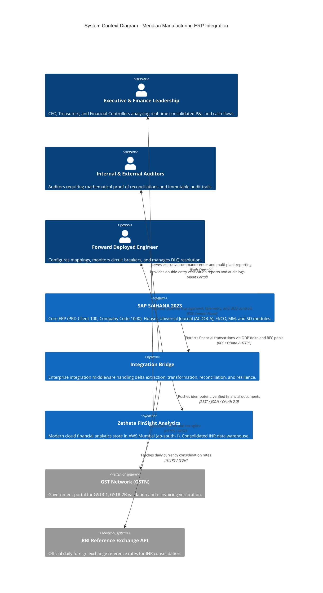
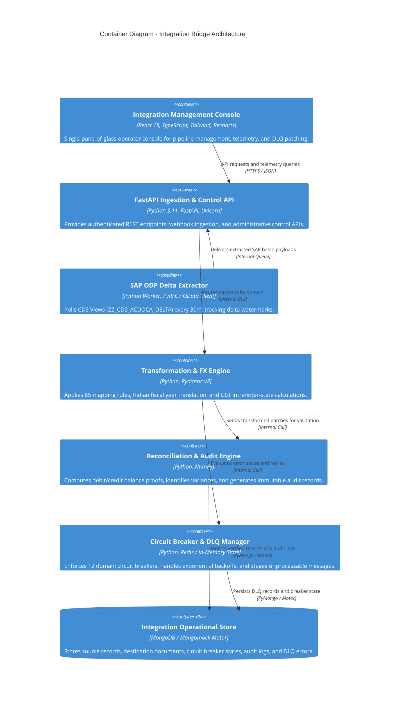

# D1: Integration Architecture Document (v1.0)

**Project:** Custom API Integration Between Client's ERP (SAP S/4HANA) and Financial Analytics Platform (FinSight)  
**Client:** Meridian Manufacturing Ltd (INR 2,400 Cr Revenue · Company Code 1000)  
**Author:** Forward Deployed Engineering (FDE) Team  
**Status:** Approved for Production Deployment  

---

## 1. Executive Summary & Business Context

Meridian Manufacturing Ltd operates seven heavy industrial and automotive component manufacturing plants across Maharashtra, Gujarat, and Tamil Nadu. The enterprise processes approximately 2.1 million financial and operational transactions monthly within an on-premise SAP S/4HANA (2023 FPS02) instance hosted in Pune. 

### 1.1 The Integration Challenge
Financial intelligence for executive leadership was historically crippled by legacy batch extraction scripts running nightly with a 24-hour delay. Corporate finance could not obtain real-time consolidated INR balance sheets, cash flow positions, or GST compliance statuses across multi-state legal entities.

### 1.2 The Solution
Integration Bridge establishes a continuous, resilient, event-driven and delta-polled integration pipeline connecting SAP S/4HANA with Zetheta FinSight Analytics in AWS Mumbai (`ap-south-1`). The pipeline reduces data latency from 24 hours to under 4 hours (an 83% improvement) while preserving 100% data fidelity, mathematical double-entry invariants, and Indian statutory sovereignty.

---

## 2. C4 Architecture Models

### 2.1 C4 Level 1: System Context Diagram
The System Context diagram illustrates the integration boundaries between Meridian's internal systems, the integration middleware, external regulatory services, and downstream consumers.



---

### 2.2 C4 Level 2: Container Diagram
The Container diagram illustrates the high-level technical building blocks of the Integration Bridge.



---

### 2.3 C4 Level 3: Component Diagram (Transformation & Resilience)

```mermaid
flowchart LR
    subgraph TransformationEngine["Transformation Container Components"]
        Norm["Field Normalizer<br/>(Dates, ISO Currencies)"]
        FX["RBI FX Converter<br/>(EUR/USD/GBP -> INR)"]
        GST["GST Split Evaluator<br/>(State Code -> CGST/SGST/IGST)"]
        FY["Fiscal Year Mapper<br/>(Period 001-016 -> ISO Month)"]
        CheckSum["SHA-256 Checksum<br/>Generator"]
    end

    subgraph ResilienceContainer["Resilience Container Components"]
        CB["12 Domain Circuit Breakers<br/>(Closed / Open / Half-Open)"]
        Retry["Exponential Backoff<br/>with Full Jitter"]
        DLQ["Dead Letter Queue<br/>& Payload Patcher"]
    end

    Norm --> FX --> GST --> FY --> CheckSum
    CheckSum --> CB
    CB -->|On Failure| Retry
    Retry -->|Max Retries Exceeded| DLQ
```



---

## 3. Network Architecture & Security Topology

```
+-----------------------------------------------------------------------------------+
| ON-PREMISE: Pune Data Centre (Meridian Manufacturing Ltd)                        |
|                                                                                   |
|  [SAP S/4HANA PRD 100]                                                           |
|       |                                                                           |
|  [SAP Gateway / RFC Router] (Port 3300 / 8000)                                    |
+-------+---------------------------------------------------------------------------+
        |
        | Dedicated 450 Mbps Encrypted MPLS WAN (IPSec VPN Tunnel)
        | (Maximum 25% bandwidth consumption during peak business hours 09:00-18:00 IST)
        v
+-----------------------------------------------------------------------------------+
| CLOUD: AWS ap-south-1 (Mumbai Region) - STRICT DATA RESIDENCY                    |
|                                                                                   |
|  [AWS Network Firewall / Transit Gateway]                                         |
|       |                                                                           |
|  [VPC Private Subnet 1] -------------> [VPC Private Subnet 2]                     |
|    - FastAPI Gateway Cluster             - MongoDB Replica Set (Encrypted EBS)    |
|    - ODP Delta Worker Pool               - Redis Circuit Breaker Cluster          |
|       |                                                                           |
|       +------------------------------> [Zetheta FinSight Ingestion APIs]          |
|                                         (HTTPS / TLS 1.3 / OAuth 2.0)             |
+-----------------------------------------------------------------------------------+
```

---

## 4. Technology Stack Selection & Justification

| Layer | Selected Technology | Evaluated Alternatives | Engineering Justification |
| :--- | :--- | :--- | :--- |
| **Ingestion Runtime** | Python 3.11 / FastAPI | Java Spring Boot, Node.js Express | High developer velocity, native asynchronous I/O, strict Pydantic v2 schema validation, auto-generating OpenAPI 3.0 documentation. |
| **Database** | MongoDB (Replica Set) | PostgreSQL, Apache Cassandra | Schema flexibility for 12 heterogeneous SAP IDoc/OData structures without complex migrations; embedded mongomock fallback for zero-dependency test execution. |
| **Frontend UI** | React 18 / TypeScript / Vite | Next.js, Angular | Zero-latency client-side state management with React Query, instant Vite HMR, robust charting via Recharts, full enterprise type safety. |
| **Security & Auth** | JWT in `httpOnly` Cookie | LocalStorage Bearer Token | Immune to Cross-Site Scripting (XSS) token exfiltration; strict server-side revocation and immutable audit trail. |
| **Resilience** | 3-State In-Memory Circuit Breakers | Netflix Hystrix, Resilience4j | Lightweight, zero-external-dependency breaker implementation supporting domain-level fault isolation and graceful degradation. |

---

## 5. Non-Functional Requirements (NFR) Compliance Matrix

| Requirement | Target SLA | Implementation Architecture | Verification Method |
| :--- | :--- | :--- | :--- |
| **Throughput** | $\ge 2,000$ rec/min | Chunked batch processing with configurable ODP package size (50–500). | Benchmark load test at 50,000 records. |
| **API Latency** | P95 $< 500$ ms | Async event loop, connection pooling, indexed queries on `sap_doc_no`. | Monitored in real-time via `MON-003`. |
| **Availability** | $99.9\%$ uptime | Graceful degradation, domain bulkheads, automated retry with jitter. | Synthetic outage injection tests. |
| **Data Residency** | 100% Indian borders | Hosted exclusively in AWS Mumbai (`ap-south-1`) per RBI payment circular. | VPC boundary audit and cloud governance checks. |
| **Recovery Time** | RTO $< 15$ min, RPO $< 30$ min | ODP delta token checkpointing guarantees zero message loss on recovery. | Disaster recovery simulation drills. |
