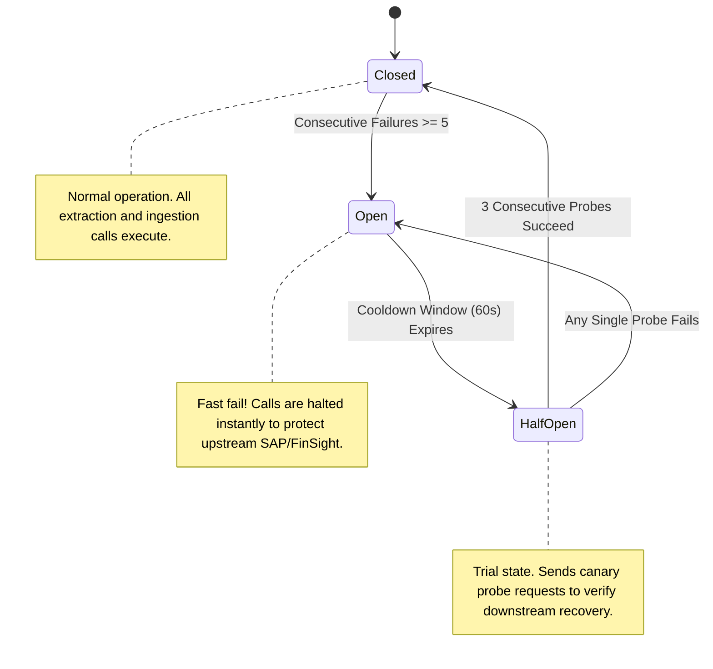

# D4: Error Handling & Retry Framework (v1.0)

**Project:** Custom API Integration Between Client's ERP (SAP S/4HANA) and Financial Analytics Platform (FinSight)  
**Standard:** Enterprise Integration Patterns (Hohpe & Woolf)  
**Status:** Approved for Production Deployment  

---

## 1. Error Classification Taxonomy (10 Error Classes)

Errors encountered across extraction, transformation, and ingestion are classified into four primary categories and ten specific error classes:

```
+-----------------------------------------------------------------------------------+
| ERROR TAXONOMY CLASSIFICATION                                                     |
+---------------------+-------------------+-------------------+---------------------+
| 1. TRANSIENT        | 2. PERMANENT      | 3. DATA QUALITY   | 4. SYSTEM           |
| (Retry with Jitter) | (Route to DLQ)    | (Business Review) | (Infrastructure P1) |
+---------------------+-------------------+-------------------+---------------------+
| - Network Timeout   | - Invalid Schema  | - Missing Field   | - Broker Offline    |
| - Connection Reset  | - Auth Failure    | - Unmatched Master| - Storage Full      |
| - Rate Limited 429  | - Rule Syntax Err | - Bad Tax Split   |                     |
+---------------------+-------------------+-------------------+---------------------+
```

| Class ID | Error Category | Source | Description | HTTP Status / Exception | Automated Handling Strategy |
| :--- | :--- | :--- | :--- | :--- | :--- |
| `ERR-EXT-001` | **TRANSIENT** | SAP RFC | RFC connection timeout after 30s | `RFC_COMMUNICATION_FAILURE` | Retry with exponential backoff with full jitter (max 3 attempts). |
| `ERR-EXT-002` | **TRANSIENT** | SAP RFC | RFC connection pool exhausted (50 active) | `RFC_RESOURCE_UNAVAILABLE` | Pause 60s, alert operations, retry with backoff. |
| `ERR-EXT-003` | **PERMANENT** | SAP ODP | ODP delta subscription invalidated | `CX_ODP_SUBSCRIPTION_INVALID` | Trip domain circuit breaker, notify integration engineering. |
| `ERR-EXT-004` | **TRANSIENT** | SAP ODP | ODP delta returned empty despite changes | `ODP_EMPTY_DELTA` | Retry once after 60s; if still empty, check ODP monitor (RSA1). |
| `ERR-MAP-001` | **DATA QUALITY** | Transform | Mandatory field is NULL in source | `SchemaValidationError` | If default value defined apply it; else route to Dead Letter Queue (DLQ). |
| `ERR-MAP-002` | **DATA QUALITY** | Transform | Date format invalid (not `YYYYMMDD`) | `InvalidDateFormat` | Attempt format correction; if unresolvable, route to DLQ. |
| `ERR-MAP-003` | **DATA QUALITY** | Transform | Referenced Cost Centre not in master | `MasterDataOrphan` | Quarantine record to Business Exception queue; alert functional team. |
| `ERR-LOAD-001`| **TRANSIENT** | FinSight API | HTTP 429 Too Many Requests | `HTTP 429` | Respect `Retry-After` response header; apply jittered backoff. |
| `ERR-LOAD-002`| **TRANSIENT** | FinSight API | HTTP 503 Service Unavailable | `HTTP 503` | Linear backoff (60s intervals, max 5 attempts); trip breaker if unrecovered. |
| `ERR-SYS-001` | **SYSTEM** | Infrastructure | Kafka broker or DB unreachable | `ConnectionError` | Trip global circuit breaker, switch to offline buffering, trigger PagerDuty P1. |

---

## 2. Exponential Backoff with Jitter Algorithm

To eliminate the "thundering herd" problem during service recovery, the Integration Bridge enforces an exponential backoff formula with full random jitter:

$$\text{WaitTime} = \min\left(\text{Cap}, \text{UniformRandom}(0, \text{Base} \times 2^{\text{attempt}})\right)$$

* **Base Wait**: 2 seconds
* **Maximum Cap**: 300 seconds (5 minutes)
* **Maximum Retry Attempts**: 5 iterations

### Python Implementation Reference
```python
import random
import asyncio

async def retry_with_jitter(operation, max_attempts=5, base=2.0, cap=300.0):
    for attempt in range(max_attempts):
        try:
            return await operation()
        except TransientException as exc:
            if attempt == max_attempts - 1:
                raise PermanentException(f"Exhausted {max_attempts} retries") from exc
            
            # Full jitter formula
            sleep_time = min(cap, random.uniform(0, base * (2 ** attempt)))
            await asyncio.sleep(sleep_time)
```

---

## 3. Circuit Breaker State Machine

Each of the 12 SAP integration domains operates under an independent 3-state Circuit Breaker to prevent cascading failures across the enterprise landscape:



### Circuit Breaker Configuration Parameters
* **Failure Threshold**: 5 consecutive execution failures.
* **Open State Timeout**: 60 seconds (cooldown duration).
* **Half-Open Success Threshold**: 3 consecutive successful probe transactions to re-close circuit.
* **Manual Override**: Operators can manually trip or reset breakers via `POST /api/errors/circuit-breakers/{domain}/reset`.

---

## 4. Dead Letter Queue (DLQ) & Remediation Workflow

When a financial record encounters unresolvable validation errors or exhausts its maximum retry quota, it is routed to the **Dead Letter Queue (DLQ)**:

1. **Isolation**: Record is stored in MongoDB collection `error_records` with full original payload, stack trace, timestamp, and error taxonomy code.
2. **Alerting**: Automated notifications are dispatched to operations Slack channels and email queues.
3. **Inspection**: Operators use the web UI (`/error-management`) to inspect the raw JSON payload and root-cause failure.
4. **In-Flight Patching**: Financial analysts can supply corrected field values (e.g. valid GSTIN, corrected amount, or sanitized date).
5. **Requeue & Replay**: Calling `POST /api/errors/dlq/{id}/requeue` executes the transformation pipeline again with the patched parameters and loads the document into FinSight.

---

## 5. Notification & SLA Escalation Matrix

| Severity Tier | Trigger Conditions | Notification Channel | Response SLA | Target Resolution |
| :--- | :--- | :--- | :--- | :--- |
| **P1 - Critical** | Global system outage, DB failure, $>10\%$ batch failure rate | PagerDuty SMS + On-Call Callout + Executive Slack | $< 15$ mins | $< 1$ hour |
| **P2 - High** | Circuit breaker OPEN on high-volume domain (`SO`, `GL`) | Operations Slack (`#alerts-p2`) + Email to Lead FDE | $< 30$ mins | $< 2$ hours |
| **P3 - Medium** | DLQ depth exceeds 50 records, individual rate limit breach | Integration Support Slack (`#alerts-p3`) | $< 2$ hours | $< 8$ hours |
| **P4 - Low** | Master data lookup warning, non-critical data quality exception | Daily Digest Email to Financial Controller | $< 24$ hours | Next batch cycle |
