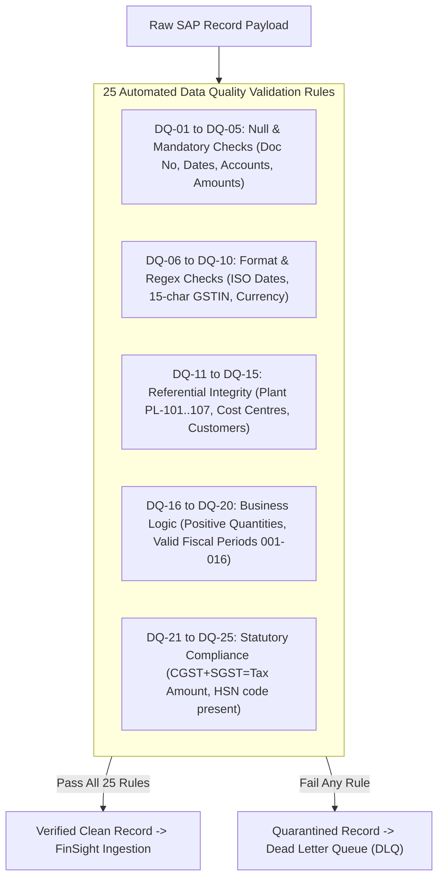

# D5: Reconciliation Framework & Data Quality Logic (v1.0)

**Project:** Custom API Integration Between Client's ERP (SAP S/4HANA) and Financial Analytics Platform (FinSight)  
**Standard:** Double-Entry Mathematical Invariants & DAMA-DMBOK Data Quality Dimensions  
**Status:** Approved for Production Deployment  

---

## 1. Executive Summary & Audit Mandate

In enterprise financial engineering, reconciliation is not optional. Dr. Sanjay Kulkarni (Head of Internal Audit) requires mathematical proof that **every rupee posted in SAP S/4HANA is accurately represented in the Zetheta FinSight Analytics store**. 

The Integration Bridge implements an automated, real-time reconciliation engine verifying that no records are dropped, duplicated, or corrupted in flight.

---

## 2. Four Reconciliation Dimensions

| Dimension | Audit Objective | Measurement Methodology | Zero-Break Tolerance |
| :--- | :--- | :--- | :--- |
| **Completeness** | Verify 100% of extracted records are accounted for in the destination or flagged in the DLQ. | $\text{Count}(\text{Source}) = \text{Count}(\text{Loaded}) + \text{Count}(\text{DLQ}) + \text{Count}(\text{Duplicates})$ | **Zero tolerance (100% match)** |
| **Accuracy** | Verify source financial values equal destination financial values after FX conversion. | $\sum \text{Amount}_{\text{Source}} \times \text{FX} = \sum \text{Amount}_{\text{FinSight}}$ | **Max variance: INR 0.05 (rounding)** |
| **Consistency** | Verify the fundamental double-entry balance equation holds across all balanced documents. | $\sum \text{Debits} = \sum \text{Credits}$ across document segments | **Zero tolerance (INR 0.00 variance)** |
| **Timeliness** | Verify records are transformed and loaded within the agreed batch SLA. | $\text{Timestamp}_{\text{Loaded}} - \text{Timestamp}_{\text{Extracted}} \le 15 \text{ mins}$ | **$\ge 98\%$ of batches within SLA** |

---

## 3. Mathematical Proof & Reconciliation Report Template (Appendix D Alignment)

Following Appendix D of the ZeTheta Assessment Document, every synchronization execution generates a formalized reconciliation report:

```
========================================================================================
MERIDIAN MANUFACTURING LTD - BATCH RECONCILIATION AUDIT REPORT
========================================================================================
Batch Identifier:            BATCH-GL-20260315-0930
Execution Window:            2026-03-15T09:30:00+05:30 to 2026-03-15T09:32:45+05:30
Domain:                      General Ledger Journal Entries (ACDOCA)
Source System:               SAP S/4HANA (PRD 100, Company Code 1000)
Target Platform:             Zetheta FinSight (Tenant: MERIDIAN-PROD, AWS ap-south-1)
Extraction Mechanism:        ODP Delta via CDS View ZZ_CDS_ACDOCA_DELTA
----------------------------------------------------------------------------------------
VOLUME RECONCILIATION
  Records Extracted from Source:           6,247
  Records Passing Schema Validation:       6,243
  Records Failing Validation (to DLQ):         4
  Records Transformed Successfully:        6,243
  Records Loaded to Target:                6,241
  Idempotent Duplicates Suppressed:            2
  Record Count Discrepancy:                    0  [PASS - 100% ACCOUNTED FOR]
----------------------------------------------------------------------------------------
FINANCIAL VALUE RECONCILIATION (INR)
  Source Debit Checksum (SUM HSL DRCRK=S):   INR 24,17,89,342.30
  Source Credit Checksum (SUM HSL DRCRK=H):  INR 24,17,89,342.30
  Target Debit Checksum (SUM Loaded DEBIT):  INR 24,17,89,342.30
  Target Credit Checksum (SUM Loaded CREDIT):INR 24,17,89,342.30
  
  Debit-Credit Balance Variance:             INR 0.00  [PASS - EQUILIBRIUM VERIFIED]
  Source-to-Target Net Amount Variance:      INR 0.00  [PASS - 100% VALUE FIDELITY]
----------------------------------------------------------------------------------------
RECONCILIATION STATUS: RECONCILED (Zero Breaks Detected)
Signed: Automated Integrity Verifier (SHA-256: 7d4a9f3b...)
========================================================================================
```

---

## 4. 25 Automated Data Quality (DQ) Validation Rules

The transformation engine executes 25 formal data quality rules prior to loading data into FinSight:



### Key DQ Rule Catalog:
* **`DQ-NULL-001`**: `sap_doc_no` must not be NULL or empty string.
* **`DQ-FMT-002`**: `doc_date` must conform to ISO 8601 (`YYYY-MM-DD`).
* **`DQ-GST-003`**: `party_gstin` must match regex `^\d{2}[A-Z]{5}\d{4}[A-Z]{1}[A-Z\d]{1}[Z]{1}[A-Z\d]{1}$`.
* **`DQ-TAX-004`**: In intra-state transactions, $|(\text{cgst} + \text{sgst}) - \text{tax\_amount}| \le 0.05$.
* **`DQ-REF-005`**: `plant_code` must exist in registered Meridian facility directory (`PL-101` through `PL-107`).
* **`DQ-VAL-006`**: Financial amount must not exceed upper bounds of `999,999,999.99 INR`.

---

## 5. Automated Variance Adjustment Workflow

When micro-variances occur (such as multi-currency rounding discrepancies below INR 1.00):
1. The discrepancy is isolated to an individual transaction line.
2. The operator or automated rule invokes `POST /api/recon/runs/{rid}/adjust`.
3. An automated compensating variance adjustment entry is booked to the **Rounding & FX Variance Suspense Account (`GL-999999`)**.
4. An immutable audit log entry is written capturing actor identity, timestamp, and variance delta.
