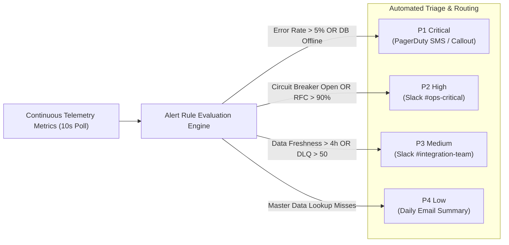

# D6: Monitoring & Alerting Dashboard Specification (v1.0)

**Project:** Custom API Integration Between Client's ERP (SAP S/4HANA) and Financial Analytics Platform (FinSight)  
**Standard:** Google SRE Observability Guidelines & Appendix F Panel Catalog  
**Status:** Approved for Production Deployment  

---

## 1. Overview & Observability Pillars

Production reliability requires holistic visibility across **Metrics**, **Structured Logs**, and **Traces**. The Integration Bridge surfaces real-time system telemetry through continuous metric computation and integration with Prometheus, Grafana, and ELK.

---

## 2. 12 Monitoring Dashboard Panels (Appendix F Alignment)

| Panel ID | Panel Title | Metric / PromQL Query | Refresh Cadence | Alert Threshold & SLA |
| :--- | :--- | :--- | :--- | :--- |
| **MON-001** | **Pipeline Health Overview** | Aggregation: GREEN if all 12 domains synced within SLA; YELLOW if any $>2$h stale; RED if $>4$h or last job failed. | 30s | **RED**: PagerDuty P1 |
| **MON-002** | **Throughput (Rec/Sec)** | `rate(records_processed_total[5m])` partitioned by domain and operation | 15s | **Warning**: $<50\%$ baseline |
| **MON-003** | **API Latency Distribution** | `histogram_quantile(0.95, rate(api_duration_seconds_bucket[5m]))` | 15s | **P95 $> 500$ ms**: Warning |
| **MON-004** | **API Error Rate (%)** | `rate(errors_total[5m]) / rate(requests_total[5m]) * 100` by error class | 15s | **$> 5\%$**: Critical P1 |
| **MON-005** | **DLQ Queue Depth** | `kafka_consumer_group_lag{topic='dlq'} + count(db.error_records)` | 30s | **$> 50$ records**: Warning; **$> 200$**: Critical P1 |
| **MON-006** | **Reconciliation Status** | Last recon result per domain: `RECONCILED` / `VARIANCE` / `BREAK` | 5m | **BREAK**: P2 High Alert |
| **MON-007** | **SAP RFC Pool Utilization** | `sap_rfc_pool_in_use / sap_rfc_pool_max * 100` (Max 50 connections) | 30s | **Pool $> 80\%$**: Warning; **$> 90\%$**: Critical |
| **MON-008** | **FinSight API Health** | `finsight_api_response_ms`, token expiration timer, remaining quota | 30s | **Headroom $< 10\%$**: P2 High |
| **MON-009** | **Data Freshness / Lag** | `now() - max(last_successful_load_timestamp)` per domain | 60s | **$> 4$ hours**: SLA Breach P3 |
| **MON-010** | **Resource Utilization** | `node_cpu_utilisation_pct`, `node_memory_utilisation_pct` | 15s | **Any $> 85\%$**: Warning; **$> 95\%$**: Critical |
| **MON-011** | **Worker Availability** | Share of the 12 domain pipelines not blocked by an open circuit breaker | 15s | **$< 95\%$**: Warning; **$< 80\%$**: Critical |
| **MON-012** | **Circuit Breaker State** | State per service domain (`0=Closed`, `1=Open`, `2=Half-Open`) | 5s | **Any Open**: P2 Alert |

---

## 3. Structured JSON Logging Standard (12 Mandatory Fields)

Every event processed by the integration pipeline emits a structured JSON log entry containing exactly 12 standard audit and diagnostic attributes:

```json
{
  "timestamp": "2026-03-15T09:32:45.120+05:30",
  "level": "INFO",
  "correlation_id": "c7a8e52b-4d9f-4321-98ab-10efc68b9412",
  "batch_id": "BATCH-GL-20260315-0930",
  "domain": "gl",
  "tenant_id": "MERIDIAN-PROD",
  "plant_code": "PL-101",
  "sap_doc_no": "0100045291",
  "operation": "TRANSFORM_AND_LOAD",
  "execution_duration_ms": 42.8,
  "status": "SUCCESS",
  "message": "Universal Journal line item converted to INR and loaded to FinSight."
}
```

---

## 4. 15+ Automated Production Alerting Rules



### Alert Rules Registry (Sample):
1. **`ALT-001` (P1)**: Total API error rate exceeds 5% over a 5-minute rolling window.
2. **`ALT-002` (P1)**: Database or message broker unreachable.
3. **`ALT-003` (P1)**: DLQ depth exceeds 200 records.
4. **`ALT-004` (P2)**: Any domain circuit breaker transitions to `OPEN`.
5. **`ALT-005` (P2)**: SAP RFC connection pool utilization exceeds 90% (45 of 50 connections).
6. **`ALT-006` (P2)**: Reconciliation reports a financial break (`VARIANCE > INR 1.00`).
7. **`ALT-007` (P3)**: Data freshness exceeds 4 hours during business operational hours.
8. **`ALT-008` (P3)**: P95 API response latency exceeds 500 ms for 15 minutes.
9. **`ALT-009` (P3)**: FinSight API rate limit headroom drops below 10%.
10. **`ALT-010` (P4)**: Host memory consumption exceeds 85% for 30 minutes.
11. **`ALT-011` (P4)**: Currency FX rate age exceeds 24 hours without sync.
12. **`ALT-012` (P4)**: Audit trail compliance drops below 99% of executed jobs.
